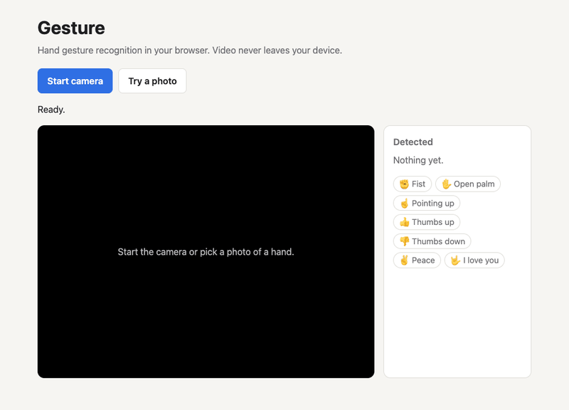
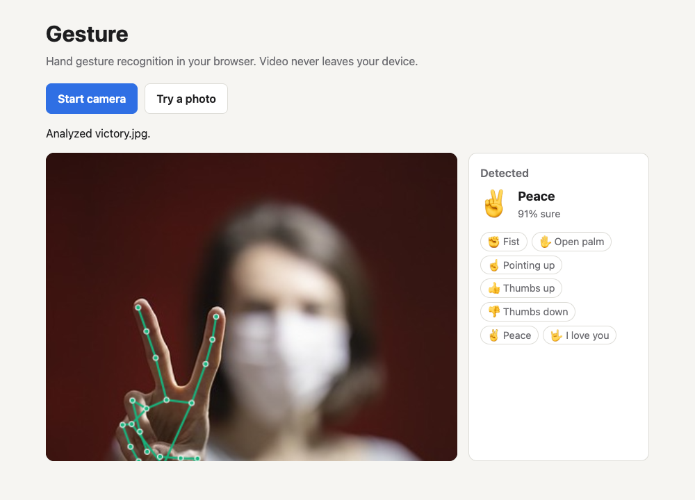
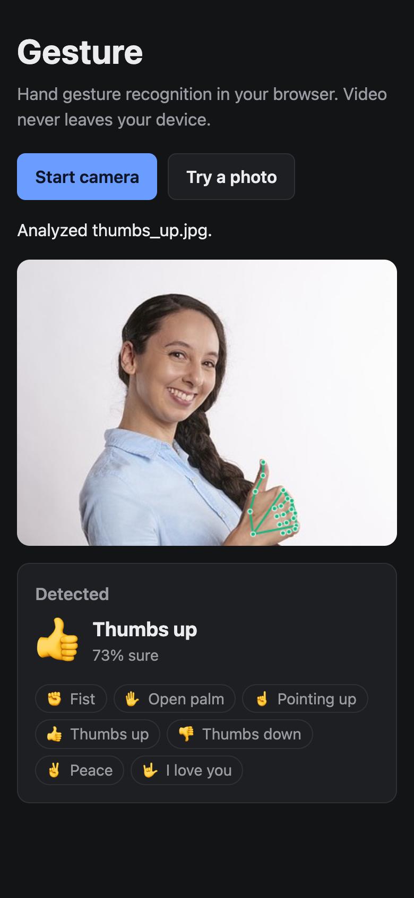
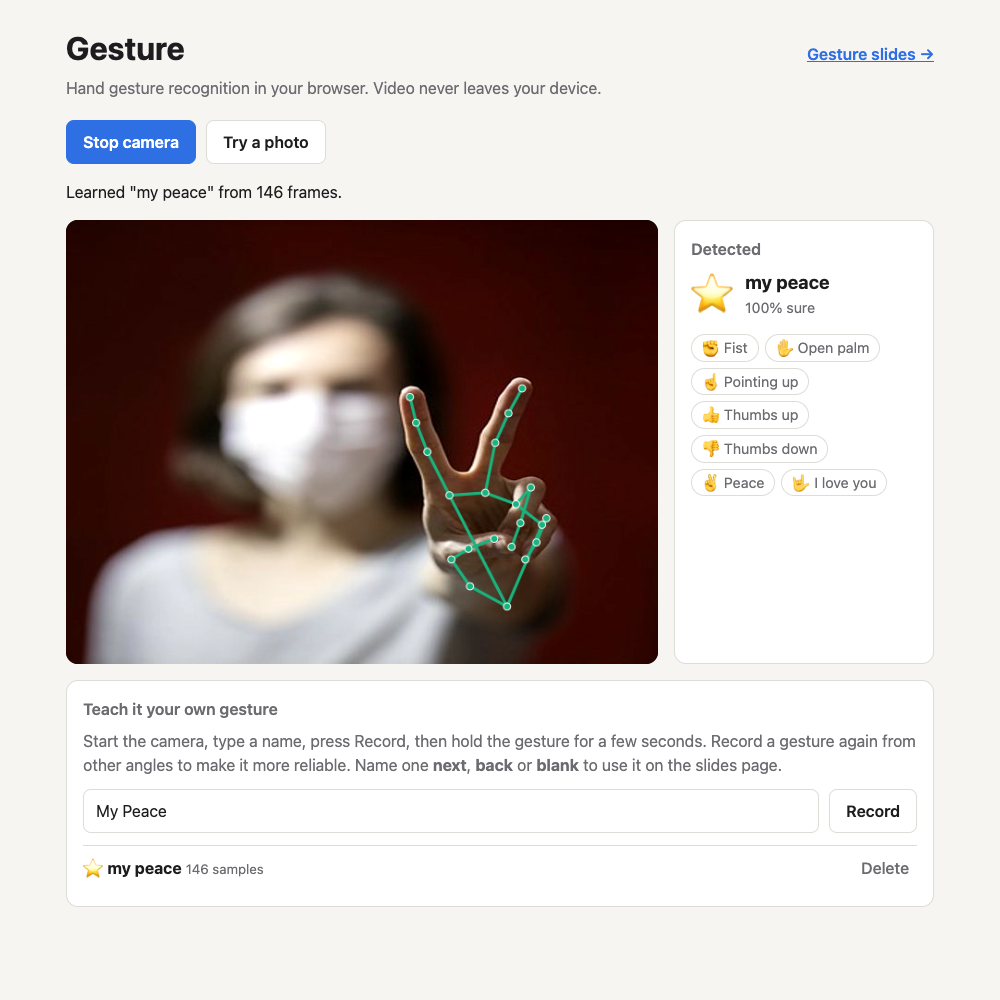
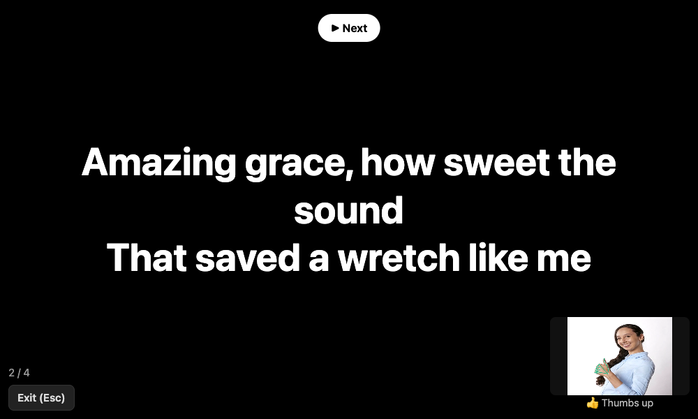

# Gesture
Hand gesture recognition in the browser, plus two things you can do with it: **teach it your own gestures** and **run slides hands-free**.

**Try it:** https://j2jun.github.io/Gesture/ (allow the camera when asked)



Runs entirely on your device with Google's [MediaPipe Gesture Recognizer](https://ai.google.dev/edge/mediapipe/solutions/vision/gesture_recognizer). No server, no API key, and video never leaves the browser.

## Recognize
Built in: ✊ Fist · ✋ Open palm · ☝️ Pointing up · 👍 Thumbs up · 👎 Thumbs down · ✌️ Peace · 🤟 I love you. Use the webcam or pick a photo. Up to two hands at once, with the hand skeleton drawn on top.

 

## Teach it your own gestures
Type a name, press **Record**, and hold a gesture for a few seconds. It learns from your recording right away, with no training step and no upload, and saves it in your browser.

How: each frame's 21 hand points are turned into 63 numbers that ignore where your hand is, how big it looks, and which hand you used. A new hand is matched to the closest recorded examples (k-nearest neighbours). If nothing is close enough, it says so instead of guessing. Your own gestures take priority over the built-in ones.



## Gesture slides
[`slides.html`](https://j2jun.github.io/Gesture/slides.html): paste lyrics or announcements (a blank line starts a new slide) and press **Present**. Built for running a church service screen from across the room.

| Gesture | Action |
|---|---|
| 👍 Thumbs up | Next slide |
| 👎 Thumbs down | Previous slide |
| ✋ Open palm | Blank screen on/off |

Hold a gesture for about half a second. Each hold fires once, so lower your hand before repeating. Keyboard works too (→ / Space, ←, B, Esc). Prefer different gestures? Teach ones named **next**, **back** or **blank** on the main page and they take over.



## Run it locally
No build step. Browsers only allow the camera on `https://` or `localhost`, so serve the folder rather than opening the file:

```bash
python3 -m http.server 8000   # then open http://localhost:8000
npm test                      # logic tests (Node 20+)
```

## Code
| File | What it does |
|---|---|
| `index.html` | Recognizer page and gesture training |
| `slides.html` | Gesture-controlled slides |
| `hands.js` | Shared browser code: model, camera, drawing, saved gestures |
| `logic.js` | Pure logic: hand features, nearest-neighbour matching, hold-to-fire trigger |
| `test/` | Tests for `logic.js`, using real hand points from MediaPipe's sample photos |

Tuning knobs: `MAX_DISTANCE` in `logic.js` (how close a custom gesture must be), and the hold time in `slides.html` (`makeTrigger(400)`). Pinned versions: `@mediapipe/tasks-vision@0.10.35` and the float16 v1 gesture model. Demo photos are MediaPipe's own gesture sample images.
